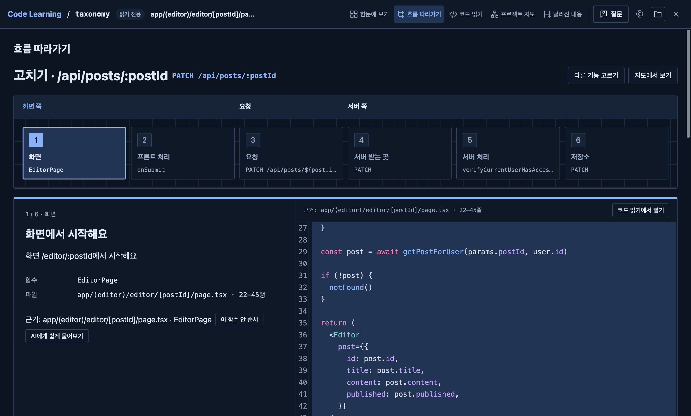
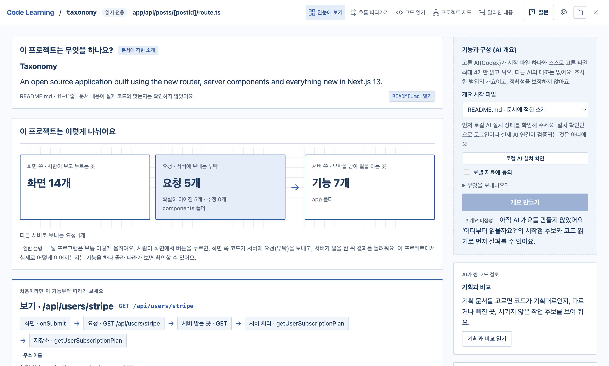
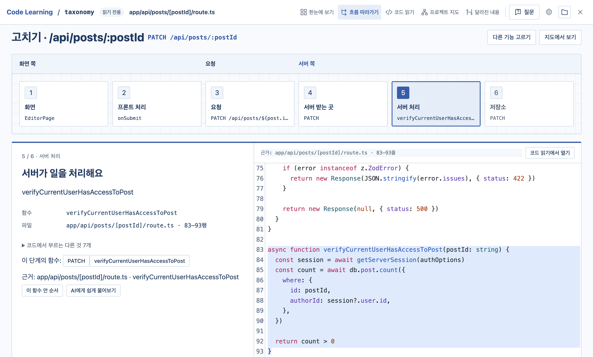
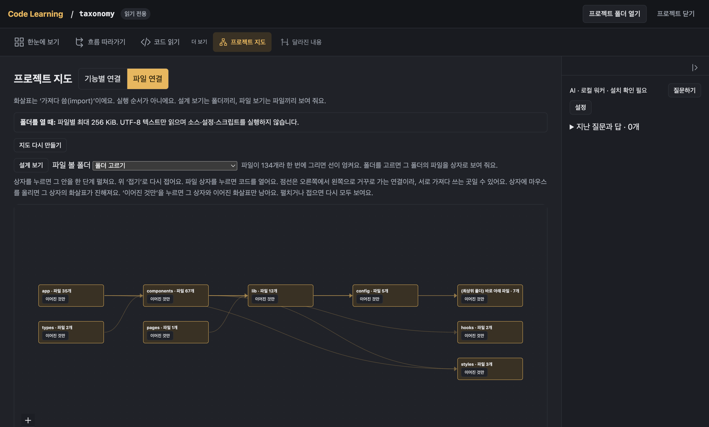
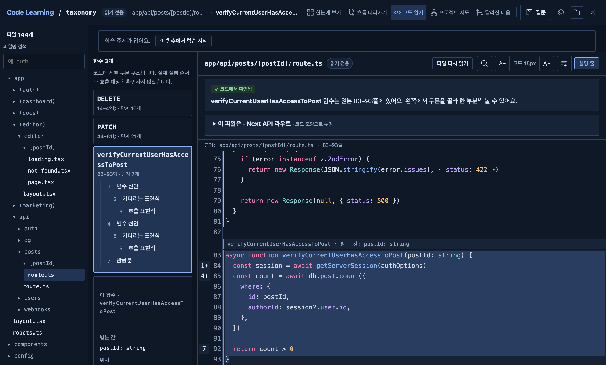

# Code Learning

**처음 보는 TS/JS 프로젝트를 코드 근거와 함께 쉽게 파악하는 읽기 전용 데스크톱 앱.**

Explore unfamiliar TypeScript and JavaScript projects with evidence from the code.

[](LICENSE)
[](#-설치)

[설치](#-설치) · [처음 사용하기](#-처음-사용하기) · [AI 기능 켜기](#-ai-기능-켜기-선택)



*이 문서의 스크린샷은 공개 프로젝트 [shadcn-ui/taxonomy](https://github.com/shadcn-ui/taxonomy)(MIT)를 연 화면입니다.*

## 🎯 이런 분께

- AI가 짜 준 코드를 읽고 검토해야 할 때
- 새 팀이나 오픈소스 프로젝트의 구조를 파악할 때
- “이 버튼을 누르면 서버에서 무슨 일이 일어날까?”가 궁금할 때

## ✨ 주요 기능

### 🗺️ 한눈에 보기

프로젝트 README의 소개와 코드에서 찾은 화면·요청·서버 기능 수를 보여 줍니다.
처음 따라갈 기능을 추천하고, 그 기능의 코드로 안내합니다. README 소개는 문서에 적힌 내용이며 코드와 일치하는지는 확인하지 않습니다.



*taxonomy의 소개와 화면·요청·서버 구성을 한곳에서 봅니다.*

### 🔀 기능 흐름 따라가기

**화면 → 프론트 처리 → 요청 → 서버 받는 곳 → 서버 처리 → 저장소(DB)**를 번호 매긴 단계로 따라갑니다. 프론트는 화면 쪽 코드, DB는 데이터를 보관하는 곳입니다.
각 단계에 실제 코드와 줄 근거가 붙습니다. 코드에서 찾은 연결을 잇고, 불확실한 연결은 **추정**으로 표시하며 찾지 못한 단계는 생략합니다.


*taxonomy의 글 수정 기능: 1단계에서 화면 코드를 확인합니다.*



*같은 기능의 5단계: 서버에서 권한을 확인하는 함수와 DB 호출 코드입니다.*

### 🧭 프로젝트 지도

폴더·파일 사이의 **import(다른 파일의 코드를 가져다 쓰는 연결)**를 그림으로 봅니다. 화살표는 실행 순서를 뜻하지 않습니다.
지도에 파일이 80개를 넘으면 폴더별로 나눠 보고, 바로 아래 파일이 30개를 넘는 폴더는 목록과 고른 파일 주변 지도로 살펴봅니다.



*taxonomy의 폴더 사이 연결입니다. 파일을 고르면 해당 코드로 이동합니다.*

### 📖 코드 읽기

파일 트리와 파일명 검색으로 코드를 찾고, 함수의 구문 단계와 해당 줄을 함께 봅니다.
**흐름 따라가기**에서는 함수가 부르는 것·부르는 곳, 값의 선언과 전달 경로, TypeScript 타입(값의 모양)을 확인합니다. 실행 중의 값이 아니라 코드에 적힌 정보입니다.



*taxonomy의 서버 파일에서 함수를 골라 읽는 화면입니다.*

### 🔍 AI가 짠 코드 검토 도우미

아무도 가져다 쓰지 않는 파일·export(다른 파일에 공개한 함수나 값) 후보와 긴 함수·깊게 중첩된 코드를 표시합니다. 삭제해도 된다는 판정은 아닙니다.
**달라진 내용**에서는 Git의 기준 커밋(저장된 변경 시점)과 지금 코드를 나란히 비교합니다. 사람이 바꿨는지 AI가 바꿨는지는 구분하지 않습니다.

### 🤖 AI 설명과 기획 대조 · 선택 기능

함수·파일 설명, 기능 정리, 코드 질문을 요청할 수 있습니다. **기획 대조**는 기획 문서와 코드를 비교해 ‘기획대로 있음·다름·확인 못 함·못 찾음·시키지 않은 작업 후보’를 보여 줍니다.
설명에 연결된 근거 버튼으로 코드를 열 수 있고, 앱은 근거와 파일 변경 여부를 다시 확인합니다. ‘못 찾음’은 구현이 없다는 확정이 아닙니다.

## 📥 설치

**아직 개발 중이라 배포한 설치 파일이 없습니다.**

M1 이후 Apple silicon Mac용으로 준비하고 있습니다. Intel Mac은 지원하지 않습니다. **Windows도 준비 중**이며, 배포되면 이곳에 추가합니다.

<details>
<summary>배포 후 첫 실행 허용 방법 (준비 중)</summary>

Apple Developer ID 서명과 공증을 받지 않아 첫 실행 때 macOS가 차단할 수 있습니다. 다음 순서로 한 번 허용해 주세요.

1. 내려받은 `.dmg`를 열고 **Code Learning**을 **Applications**로 끌어 놓습니다.
2. Applications에서 앱을 엽니다. “확인할 수 없음” 경고가 나오면 **완료**로 닫습니다.
3. **시스템 설정 → 개인정보 보호 및 보안**의 아래쪽에서 Code Learning 차단 안내 옆 **그래도 열기**를 누릅니다.
4. Mac 로그인 암호를 입력하고 **열기**를 누릅니다. 다음부터는 앱을 바로 열 수 있습니다.

macOS 버전에 따라 버튼 문구가 다를 수 있습니다. [Apple의 실행 허용 안내](https://support.apple.com/guide/mac-help/open-a-mac-app-from-an-unknown-developer-mh40616/mac)도 참고하세요.

터미널을 쓰는 경우, 공식 배포 파일을 Applications에 옮긴 뒤 다음 명령을 실행할 수도 있습니다.

```sh
xattr -dr com.apple.quarantine "/Applications/Code Learning.app"
```

이 명령은 해당 앱과 그 안의 파일에서 다운로드 격리 표시를 지워 첫 실행 차단을 해제합니다.

</details>

<details>
<summary>Windows 첫 실행 허용 방법 (준비 중)</summary>

서명하지 않은 설치 파일(`Code-Learning-win-x64-Setup.exe`)이라 처음 실행할 때 “Windows의 PC 보호” 화면이 나올 수 있습니다. **추가 정보 → 실행**을 눌러 주세요.

설치는 관리자 권한 없이 내 계정에 됩니다. 시작 메뉴와 바탕화면에 **Code Learning** 바로가기가 생깁니다.

제거하려면 **설정 → 앱**에서 **Code Learning**을 골라 **제거**를 누릅니다.

</details>

## 🚀 처음 사용하기

1. **프로젝트 폴더 열기**로 살펴볼 폴더를 고릅니다.
2. **한눈에 보기**에서 소개와 구성을 확인합니다.
3. 추천된 **이 기능부터 따라가기**를 눌러 단계별 코드를 읽습니다. 서버 기능을 찾지 못했다면 **어디부터 읽을까요?**에서 시작 파일을 고릅니다.
4. **프로젝트 지도**에서 폴더·파일 연결을 살펴봅니다.

코드 분석은 **TypeScript·JavaScript**를 지원합니다. 기능 흐름은 NestJS·Next API·Express 서버와 `fetch`·`axios` 요청을 찾습니다.
폴더 탐색은 **최대 1,000개 파일**, 파일당 **256 KiB**, **UTF-8** 텍스트로 제한합니다. 제외한 파일은 이유를 표시하며, 탐색 한도에 닿으면 더 작은 폴더를 열어 주세요.

## 🤖 AI 기능 켜기 (선택)

**코드 탐색·흐름·지도·변경 비교는 AI 없이도 동작합니다.** AI 설명과 기획 대조는 원할 때 보낼 자료에 동의한 뒤 요청합니다.
‘로컬’은 AI 실행기가 내 컴퓨터에서 돌아간다는 뜻입니다. 답변은 각 AI 제공자의 서버에서 만듭니다.

### macOS

| 방식 | 필요한 프로그램 | 동작 |
|---|---|---|
| 로컬 워커 · 기본 | Codex + Antigravity | Codex가 자료를 고르고 검토하며, Gemini가 설명 |
| Codex 단독 | Codex | Codex가 설명, 다른 AI의 대조 없음 |
| Gemini 단독 | Antigravity | Gemini가 설명, 다른 AI의 대조 없음 |

Claude Code 연결은 준비 중입니다.

**1. 필요한 CLI를 설치합니다.** CLI는 터미널에서 실행하는 프로그램입니다.

- **Codex CLI · OpenAI:** [공식 설치 안내](https://developers.openai.com/codex/cli/)에 따라 설치하고 ChatGPT 계정으로 로그인합니다.
- **Antigravity CLI · Google:** [공식 설치 안내](https://antigravity.google/docs/getting-started)의 CLI 항목에서 `agy`를 설치합니다. 앱의 Gemini 요청은 **3.8 Flash · High**(`gemini-3.8-flash-high`)로 고정됩니다.

앱은 `~/.local/bin`, `~/.npm-global/bin`, `/opt/homebrew/bin`, `/usr/local/bin`에서만 실행 파일을 찾습니다. 다른 위치에 설치했다면 앱의 설치 확인에서 찾지 못할 수 있습니다.

**2. 앱 전용 폴더로 처음 한 번 로그인합니다.** 개인 AI 설정과 분리하므로 기존 터미널 로그인만으로는 연결되지 않을 수 있습니다. 아래 명령은 **macOS 터미널**에서 실행하세요.

Codex:

```sh
CODEX_HOME="$HOME/Library/Application Support/Code Learning/codex-home" codex login
```

Antigravity:

```sh
HOME="$HOME/Library/Application Support/Code Learning/agy-home" agy
```

Antigravity는 실행 후 로그인을 마치고 종료합니다. 이 앱 전용 HOME 방식은 Antigravity의 공식 설정 기능이 아니므로 CLI 업데이트의 영향을 받을 수 있습니다.

**3. 앱에서 질문합니다.** 위 **질문** 버튼으로 질문 칸을 열면 설치 확인이 자동으로 시작합니다. 방식은 질문 칸의 **설정**에서 고릅니다. **코드 읽기**에서 함수나 구문을 고른 뒤 질문을 적고, **무엇을 보내나요?**를 확인해 전송에 동의합니다.

설치 확인은 실행 파일과 버전만 확인합니다. 로그인이나 이용 한도에 문제가 있으면 AI 요청이 실패합니다. 로컬 워커에서 Antigravity만 로그인되지 않았다면 자료가 Codex에 먼저 전송된 뒤 실패할 수 있습니다.

### Windows · 실험 기능

**Codex 단독만 쓸 수 있으며, 실제 Windows PC에서 확인하지 못했습니다.** macOS의 접근 제한 장치(울타리) 없이 실행합니다. 도구 차단이 새면 Codex가 이 PC의 파일을 읽거나 바꿀 수 있습니다.

**1. Node.js와 Codex를 설치합니다.** Node.js는 공식 설치 프로그램으로 `C:\Program Files\nodejs`에 설치합니다. Codex는 `npm install -g @openai/codex`로 기본 전역 위치인 `%APPDATA%\npm`에 설치합니다. 앱은 이 위치들에서만 찾으며, 다른 위치에 설치하면 찾지 못합니다.

**2. PowerShell에서 앱 전용 폴더로 처음 한 번 로그인합니다.**

```powershell
$env:CODEX_HOME="$env:APPDATA\Code Learning\codex-home"; codex login
```

**3. 앱의 질문 칸 → 설정에서 Codex 단독을 고릅니다.** 보낼 자료를 확인하고 전송에 동의하면 **질문·파일 설명·기능 정리·기획 대조**를 요청할 수 있습니다. 설치 확인은 실행 파일과 버전만 확인하므로, 로그인이나 이용 한도에 문제가 있으면 요청이 실패합니다.

**로컬 워커·Gemini 단독·AI 개요는 쓸 수 없습니다.** AI 개요는 로컬 워커로 고정되어 있습니다.

## 🔒 안전과 개인정보

- **읽기 전용:** 프로젝트 파일을 바꾸거나 프로젝트의 코드·설정·스크립트를 실행하지 않습니다.
- **AI를 쓰지 않을 때:** 코드를 외부로 보내지 않습니다. 앱은 사용 기록을 외부로 수집하는 기능(텔레메트리)을 두지 않습니다.
- **AI를 쓸 때:** 화면의 **무엇을 보내나요?**에 안내한 자료를 동의 후 해당 AI 제공자에게 보냅니다. 전송 전에 흔한 비밀값 형태를 `[MASKED_SECRET]` 등으로 가리지만, 비밀값을 전부 찾는다고 보장하지 않습니다.
- **AI 실행 제한:** 실행기는 앱 전용 홈과 임시 폴더를 쓰며, macOS에서는 접근 제한 장치(`sandbox-exec`) 안에서 실행합니다. 도구 사용을 제한하지만 **차단은 시험한 범위만 확인**했습니다. 네트워크 전송 자체는 막지 않으며, macOS에서 이 장치를 사용할 수 없으면 AI를 실행하지 않습니다. Windows의 Codex 단독은 이 장치 없이 실행하므로 도구 차단이 새면 이 PC의 파일을 읽거나 바꿀 수 있습니다. [알려진 한계 전체](docs/development.md#알려진-한계)를 확인하세요.
- **이 Mac에 저장:** 최근 프로젝트·학습 위치·AI 결과는 `~/Library/Application Support/Code Learning/learning.sqlite`에 저장합니다. AI CLI도 앱 전용 폴더에 자체 기록을 남길 수 있으며, 그 보관·삭제 정책은 아직 확인하지 못했습니다.

## ⚠️ 알려진 한계

- 코드 분석은 TS/JS만 지원합니다. 문서 등 일부 텍스트 파일은 읽을 수 있습니다.
- 주소 문자열과 코드 모양으로 연결을 찾습니다. 실제 실행을 확인한 결과가 아닙니다.
- 경로 별칭(예: `@/…`)은 일부만 지원하며, Fastify·Hono·Koa 등은 기능 흐름 분석 대상이 아닙니다.
- AI 답과 기획 대조는 정확성을 보장하지 않습니다. 근거 코드가 바뀌면 다시 확인해야 하며, 오래된 근거로 이동하는 기능은 막힙니다.
- Windows AI는 **Codex 단독만 가능한 실험 기능**이며 실제 Windows PC에서 확인하지 못했습니다. macOS의 울타리 없이 실행해 도구 차단이 새면 이 PC의 파일을 읽거나 바꿀 수 있습니다.
- 취소·시간 초과 때 AI 프로그램과 하위 프로세스(그 프로그램이 띄운 다른 프로그램)를 끝내려고 하지만, 전부 끝난다고 보장하지 않습니다. Windows에서 종료 명령(`taskkill`)이 실패하거나 프로그램이 2초 안에 끝나지 않으면 남을 수 있습니다. 두 운영체제 모두 CLI가 하위 프로세스를 일부러 떼어 놓고 먼저 끝내면 그 하위 프로세스가 남을 수 있습니다.
- CLI 업데이트로 AI 동작과 도구 제한이 달라질 수 있습니다. 자세한 내용은 [개발 문서의 알려진 한계](docs/development.md#알려진-한계)에 있습니다.

## 🛠️ 개발

macOS Apple silicon·**Node.js 24** 환경을 기준으로 합니다. 저장소 폴더에서 실행하세요.

```sh
npm ci
npm start
```

검증은 다음 순서로 실행합니다. 화면 검사는 서로 영향을 주지 않도록 하나씩 실행하세요.

```sh
npm run typecheck
npm test
npm run package
npm run test:electron
npm run test:packaged
```

설치 파일 만들기:

```sh
npm run make
```

결과는 `out/make/Code-Learning-mac-arm64.dmg`에 생성됩니다.
구조와 추가 검증은 [개발 문서](docs/development.md), 시험 기록은 [구현 상태](docs/implementation-status.md)를 참고하세요.

## 📄 라이선스

[MIT](LICENSE)
